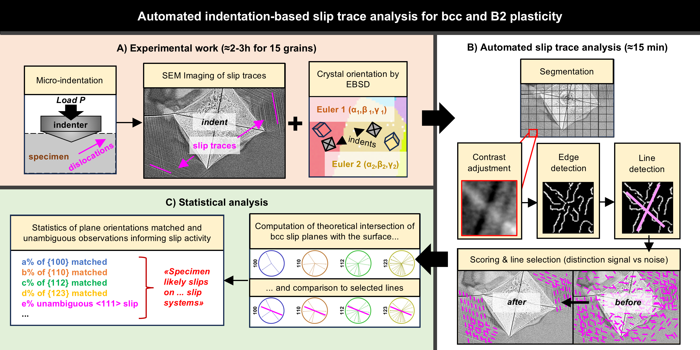

# RAST: Rapid Analysis of Slip Traces

RAST detects slip traces on SEM pictures of indents and matches them, using the EBSD orientation of each grain, to the
slip-plane families that could have produced them ({100}, {110}, {112}, {123} for bcc/B2; {111} for fcc).

RAST is described in:

> V. Gagneur, J. P. Magnussen, K. Ma, M. J. Lloyd, N. Martin, A. J. Knowles, *Automated indentation-based slip trace
> analysis for bcc and B2 intermetallic plasticity*, Materials Characterization 229 (2025) 115524.
> https://doi.org/10.1016/j.matchar.2025.115524

## Which version do I want?

| Version | Where | Use it if |
|---|---|---|
| **1.0** (MATLAB) | [`matlab-1.0-legacy/`](matlab-1.0-legacy/), or the [`v1.0` tag](https://github.com/vgagneur/RAST/tree/v1.0) | you want to reproduce the paper exactly: this is the code used for it |
| **1.1 Python** (preview) | [`python/`](python/) | new analyses without a MATLAB licence; tutorials in [`python/docs`](python/docs) |
| **1.1 MATLAB** (preview) | [`matlab/`](matlab/) | new analyses in MATLAB |

**This branch is a preview of RAST 1.1.** 1.1 fixes how near-vertical lines (close to ±90°) are matched and scored,
and adds a Python version of the whole pipeline. Both 1.1 versions are being checked on the reference datasets
before release. See [CHANGELOG.md](CHANGELOG.md).

Working with an AI coding agent? It will find its notes in [AGENTS.md](AGENTS.md); see
[Tutorial 3](python/docs/tutorial_3_ai_agent.md).

## Getting started with 1.0 (MATLAB)

Requires MATLAB with the Image Processing Toolbox.

1. Run `RAST_Loading.m` to load your SEM pictures, crop and mask them, and enter the EBSD Euler angles (Bunge
   convention, degrees) of each picture. This saves a `.mat` dataset.
2. Set the dataset name and the parameters in section (1) of `RAST_Running.m`, then run it. Figures and an Excel table
   are written to a new folder.
3. Analyse the Excel table as explained in `data_analysis_tutorial.txt`.

Comments in each `.m` file explain the parameters. Demo data (B2 Ti2AlMo, `demo_B2_tialmo.mat`) is attached to the
[v1.0 release](https://github.com/vgagneur/RAST/releases/tag/v1.0).

## Contact

Vincent Gagneur, vincent26100@gmail.com

## Licence

MIT, see [LICENSE](LICENSE).
